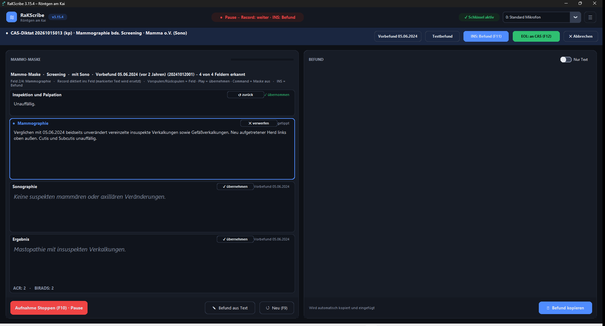
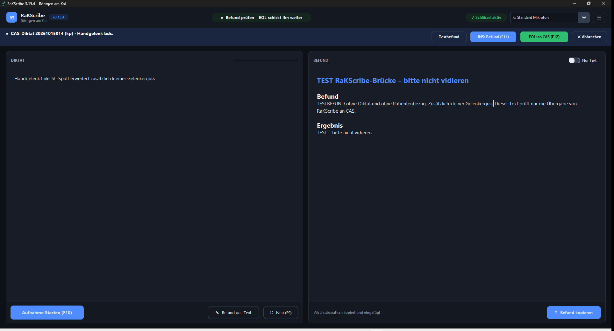
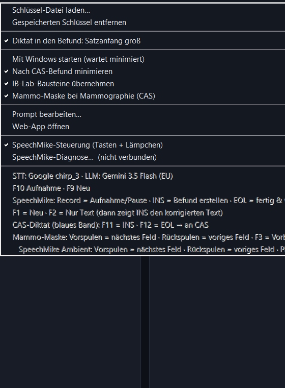

# Bericht: Mammo-Maske am SpeechMike Ambient, Markieren/Überschreiben und Widerspruchs-Prüfung (RaKScribe 3.15.4 + 3.15.5)

Stand 15.10.2026 · Auftrag „Maske am Ambient“ mit den Nachträgen 1–4 und „ohne Peter“ · alle Beispiele synthetisch,
keine Patientendaten.

## Das Wichtigste in Kürze

- **3.15.4 (EXE + Web):** Die Mammo-Maske geht jetzt mit deinem SpeechMike Ambient: Vorspulen/Rückspulen = Feld,
  **Play = Vorbefund übernehmen**, **Command = Maske aus/an**. Das nächste Diktat überschreibt markierten Text, in der
  Pause kannst du tippen und löschen, F3/F4 gehen auch auf der Tastatur. Außerdem repariert: die genaue
  Spracherkennung (chirp_3) lief in der EXE **nie** (Schlüssel ohne Scope), eine beidseitige CAS-Leistung ergibt jetzt
  immer einen beidseitigen Befund, Drüberdiktieren rechts geht auch nach einer Pause, die Häkchen im Menü sind sichtbar.
- **3.15.5 (EXE + Web):** Ein diktierter umschriebener Knochenbefund (Fersensporn, Fibroostose am Trochanter,
  Osteophyt …) widerspricht dem Normaltext der Vorlage nicht mehr – in **allen** Skelett-Vorlagen. Nur der betroffene
  Normalsatz wird eingeschränkt („Im Übrigen …“), der Rest bleibt wörtlich, das Ergebnis nennt den Befund.
- **Geprüft:** Offline-Tests und CI grün · Windows-UI-Test der echten EXE 107/107 (3.15.4 und 3.15.5) · Web-App live mit
  3.15.5 · Gast-Probelauf am Büro-PC (Ordi-Hermes, eigene Kopie, nichts in X:) mit 3.15.4: 18/18 + 17/17, mit 3.15.5:
  18/18 + 18/18 (inkl. eingebautem Prompt-Marker) · Live-Check mit Gemini: EXE 8/8, Web 8/8.
- **Für dich am Montag:** drei kurze Punkte, Liste ganz unten.

## 1. Was am Büro-PC los war (Protokoll 15.10., ausgelesen vom Ordi-Hermes)

| Beobachtung | Ursache | ab 3.15.4 |
|---|---|---|
| F3/F4 der Maske „reagieren nicht“ | Das SpeechMike Ambient (PSM5000) hat keine F-Tasten. Es meldet sich bei Windows als „SpeechMike III“ (USB 0911:0C1D) und ist nur an der Seriennummer „PSM5…“ zu erkennen. Auf der Tastatur waren F3/F4 nicht belegt. | Belegung je erkanntem Gerät; F3/F4 auch auf der Tastatur |
| Feldwechsel nur per Mausklick; im Protokoll nur Record, Command, INS, EOL | Vorspulen, Rückspulen und Play kamen am 15.10. nie an (nicht gedrückt oder vom Philips-Treiber abgefangen – das klärt die Tastenprobe am Montag) | Spulen = Feld, Play = übernehmen (Bits laut Philips-SDK) |
| Tippen/Löschen in der Maske ging nicht | Felder waren auch in der Pause gesperrt | gesperrt nur während Aufnahme und Verarbeitung |
| Befunde nur aus dem Live-Transkript | Die Schlüssel für chirp_3 wurden ohne Scope angelegt → jede Volltranskription scheiterte mit „invalid_scope“ (18 von 18), RaKScribe nahm still das schwächere Live-Transkript | Scope `cloud-platform` (wie alle Werkzeuge am Mac) |
| „Handgelenk bds.“ → einseitiger Befund | Die Seite „beidseits“ der CAS-Leistung wurde der KI überlassen | deterministisch beidseits |
| Drüberdiktieren rechts ging nicht | Die Einfügestelle wurde nur beim Start der Aufnahme gelesen, nicht nach einer Pause | auch nach der Pause (wie seit 3.5.0 beim Start) |
| Häkchen/Schalter kaum sichtbar | schwarz auf dunkelblau | weiß, Schalter mit hellem Knopf und Rahmen |

## 2. Tasten der Mammo-Maske (ab 3.15.4)

| Aufgabe | SpeechMike III / Premium | SpeechMike Ambient | Tastatur |
|---|---|---|---|
| nächstes / voriges Feld | Vorspulen / Rückspulen | Vorspulen / Rückspulen | Bild↓ / Bild↑ |
| ins aktive Feld diktieren (Pause/Weiter wie gewohnt) | Record | Record | F10 |
| Vorbefund dieses Felds übernehmen (noch einmal = zurück); bei heutigem Text 2× = verwerfen | F3 | **Play** | F3 |
| Maske aus = freies Diktat wie bisher (noch einmal = an) | F4 | **Command** | F4 |
| Befund zur Kontrolle / an CAS | INS / EOL | INS / EOL | F11 / F12 |

- **Welches Gerät?** RaKScribe erkennt das Ambient an der Seriennummer; die Hilfezeile über den Feldern zeigt dann
  „Vorspulen/Rückspulen = Feld · Play = übernehmen · Command = Maske aus“. Ein SpeechMike III/Premium (z. B. am anderen
  PC) bleibt bei F3/F4 – dort ändert sich nichts. Ohne SpeechMike zeigt die Zeile die Tastatur.
- **Play** zählt beim Loslassen (höchstens 3 s gehalten, nie als Schieberstellung). Außerhalb der Maske macht Play wie
  bisher nichts; Command außerhalb der Maske auch nicht.
- **F1 „Neu“ und F2 „Nur Text“ am Ambient – ehrlich:** Das Ambient hat diese Tasten nicht, und alle seine Tasten sind
  belegt (Record, Spulen, Play, Command, INS, EOL). „Neu“ geht mit **F9** auf der Tastatur bzw. dem Knopf „↺ Neu (F9)“,
  „Nur Text“ mit dem **Schalter oben rechts** im Befund. Am SpeechMike III/Premium bleiben F1/F2 wie bisher.
- **Eigene Belegung**, falls die Tastenprobe etwas anderes zeigt: `config.ini` `[MASKE]`, fürs Ambient
  `AMBIENT_NAECHSTES_FELD`, `AMBIENT_VORIGES_FELD`, `AMBIENT_UEBERNEHMEN`, `AMBIENT_MASKE_UMSCHALTEN`.
- F10/F11/F12 bleiben, wie sie sind; Entf und Rücktaste löschen im Feld ganz normal.

## 3. Markieren, Überschreiben, selbst Löschen (3.15.4)

- **Markierung** im aktiven Feld → das nächste Diktat ersetzt genau die Markierung (auch im grauen Vorbefund; der Rest
  des Vorbefunds gilt dann als getippt). Strg+A markiert den ganzen Feldtext.
- **Cursor** in einem Feld mit heutigem Text → das Diktat kommt an diese Stelle.
- **Weder noch** → wie bisher: das erste Diktat ersetzt den Vorschlag, weitere hängen an.
- **In der Pause** gehen Tippen, Markieren, Entf und die Knöpfe „✓ übernehmen“/„✕ verwerfen“. Ganz gelöscht → das Feld
  ist leer und kommt nicht in den Befund; „✕ verwerfen“ holt den Vorschlag zurück.
- An Gemini geht weiterhin nur dein Diktat, nie der Vorbefund.

Aus dem Windows-UI-Test (echte EXE, synthetische Texte):







## 4. Weitere Korrekturen in 3.15.4

- **chirp_3:** Die Schlüssel bekommen jetzt den Scope; nach deinem ersten echten Diktat muss im Protokoll
  „[CHIRP3] OK: … Zeichen“ stehen statt „Token-Fehler“ (das liest Hermes nach, du musst nichts tun).
- **Beidseits aus CAS:** Ist die CAS-Leistung einer paarigen Region beidseits („bds.“, „beidseits“, „bilateral“),
  heißt die Überschrift immer „… beidseits in 2 Ebenen“ – auch wenn nur eine Seite diktiert wurde; der Gen-Prompt
  bekommt die Regel für den beidseitigen Text, das Band einen Hinweis. Einseitige Leistungen bleiben einseitig,
  Wirbelsäule/Becken nie „beidseits“. Getestet für Handgelenk, Knie, Hüfte, Schulter, Fuß.
- **Drüberdiktieren rechts / „Nur Text“:** Record → Pause → in den Befund klicken oder Text markieren → Record →
  INS setzt das Diktat an diese Stelle (mit „Nur Text“ ersetzt es die Markierung). Gilt auch im CAS-Band.
- **Häkchen** im ☰-Menü weiß, Schalter „Nur Text“ mit hellem Knopf und sichtbarem Rahmen auch ausgeschaltet.

## 5. Widerspruchs-Prüfung für umschriebene Skelettbefunde (3.15.5)

Dein Anlass: Fersensporn diktiert, aber „Normale Form des Calcaneus …“ blieb stehen. Gelöst für alle Skelett-Vorlagen
(Röntgen, CT/MR, Prothesen, Ordi-Bausteine mit Skelett-Normaltext), gleich in EXE und Web:

1. **Katalog als Daten** (`vorlagen_vorrang.json` → `widersprueche`): 20 Befund-Kategorien (Fibroostose/Enthesiopathie/
   Sporn, Exostose, Osteophyt, Arthrose inkl. AC/ISG/Finger/Zehen/Kiefergelenk, Spondylose, Spondylarthrose,
   Osteochondrose, Unkovertebralarthrose, Baastrup, DISH, Verkalkung, Chondrokalzinose, Os accessorium/Sesambein,
   Enostose, Zyste, alte Fraktur, Fehlstellung, Osteopenie, Skoliose, Sklerose) mit ihren Beschreibungswörtern,
   21 Normalsatz-Merkmale (Form, Kontur, Kortikalis, Gelenkspalt, „keine Verkalkungen“ …) und 25 Strukturgruppen, damit
   nur die betroffene Struktur eingeschränkt wird (Trochanter major ≠ Hüftgelenk, ISG ≠ Hüftgelenke, Unkovertebral- ≠
   Facettengelenke). Verneinte Befunde („kein Fersensporn“) zählen nicht.
2. **Vor der KI:** Widerspricht ein Vorlagensatz einem diktierten Befund, bekommt Gemini genau diese Sätze genannt
   (Block `<widersprueche>`), dazu eine neue Konflikt-Regel mit Beispielen (Calcaneus, Hüfte) im Prompt (Marker
   `2026-10-15-v3155-umschriebene-befunde`) und eine Zeile im Web-Prüfer.
3. **Nach der KI (deterministisch):** Bleibt trotzdem ein widersprechender Normalsatz stehen, wird nur er zu
   „Im Übrigen …“, der Befundsatz rückt davor; fehlt der Befund im Befundtext, kommt dein diktierter Teilsatz dorthin;
   das Ergebnis nennt den Befund (mit Seite) statt „Regelrechte Darstellung …“. Ohne diktierten Befund bleibt der Text
   Zeichen für Zeichen gleich.

**Live mit Gemini (EXE-Kette, so wie RaKScribe ihn baut):**

Diktat „Calcaneus rechts: Fersensporn plantar, ansonsten unauffällig“:

```text
## Calcaneus rechts in 2 Ebenen

## Befund
Plantarer Fersensporn. Im Übrigen normale Form des Calcaneus mit regelrechten Winkelmaßen. Die Stellung zu Talus und Os cuboideum ist normal ohne Hinweis auf Fehlstellung. Mineralgehalt und Knochenstruktur sind regelrecht bei scharfer Abgrenzbarkeit der Spongiosabälkchen. Im Übrigen glatte und scharfe Begrenzung der normal breiten Kortikalis ohne pathologische Konturunterbrechung. Normale Weite der Gelenkspalten bei kongruenten Gelenkflächen. Die übrigen mitdargestellten Fußwurzelknochen sind unauffällig.

Unauffällige Weichteile.

## Ergebnis
1. Plantarer Fersensporn rechts.
```

Diktat „Hüfte links: Fibroostose am Trochanter major, sonst unauffällig“ – der Hüftgelenk-Satz bleibt, nur der Kortikalis-Satz wird eingeschränkt:

```text
## Hüftgelenk links in 2 Ebenen

## Befund
Anatomisch normale Form des Hüftgelenkes mit regelrechter Stellung des Hüftkopfes in der Pfanne. Der CCD-Winkel ist im Normbereich. Mineralgehalt und Knochenstruktur sind regelrecht. Fibroostose am Trochanter major. Im Übrigen sind die kortikalen Randkonturen normal breit, scharf und glatt abgrenzbar ohne pathologische Konturunterbrechungen. Normal konfigurierte, glatte Gelenkflächen mit allseits normal weitem Gelenkspalt. Die artikulierenden Flächen sind kongruent bei guter Deckung des Hüftkopfes durch die Pfanne. Unauffällige Weichteile.

## Ergebnis
1. Fibroostose am Trochanter major links.
```

**Live-Check** (`tools/verify_widerspruch.py`, 5 Befunde: Fersensporn plantar, Fibroostose Trochanter major an Hüfte
und Becken, Enthesiopathie Olecranon, Osteophyt Patellaoberpol + 3 Gegenproben: unauffällig, „kein Fersensporn“,
Gonarthrose nur mit Deskriptoren): **EXE 8/8, Web 8/8.** In der EXE lieferte Gemini mit dem neuen Prompt-Block alle
8 Befunde schon selbst widerspruchsfrei; die Nachprüfung musste nicht eingreifen. In der Web-Kette schreibt der Prüfer
„Fibroostose“ gern in eine Beschreibung um („knöcherne Ausziehung“) – die Nachprüfung kennt diese Beschreibungen jetzt
und hängt die Diagnose nicht doppelt an. Nebenbei: Der Web-Prüfer gab einem einzelnen Osteophyten eine
Kellgren-&-Lawrence-Graduierung, obwohl keine Arthrose diktiert war – abgestellt.

**Matrix über alle Skelett-Vorlagen** (`tests/offline/widerspruch_matrix_test.py`, läuft in der CI): je Vorlage und
passender Kategorie ein Diktat „<Vorlage>: <Befund>, ansonsten unauffällig“ mit dem typischen KI-Fehler (Befundsatz
eingefügt, Normalsätze stehen gelassen) durch die Nachprüfung, Web = EXE Zeichen für Zeichen, plus je 2 Gegenproben.
Ergebnis: **98 Vorlagen/Bausteine · 1062 Kombinationen · 0 Fehler · 200/200 Gegenproben unverändert · Web = EXE.**

| Kategorie | Vorlagen | ✓ Normalsatz eingeschränkt | – kein Normalsatz betroffen | ✗ Fehler |
|---|---|---|---|---|
| Fibroostose/Enthesiopathie/Sporn | 86 | 70 | 16 | 0 |
| Exostose/Osteochondrom | 71 | 55 | 16 | 0 |
| Osteophyt/Randzacke | 55 | 45 | 10 | 0 |
| Arthrose (jedes Gelenk inkl. AC, ISG, Finger, Zehen, Kiefergelenk) | 60 | 50 | 10 | 0 |
| Spondylose/Spondylophyten | 22 | 14 | 8 | 0 |
| Osteochondrose/Diskopathie | 22 | 19 | 3 | 0 |
| Spondylarthrose/Facettenarthrose | 22 | 9 | 13 | 0 |
| Unkovertebralarthrose | 11 | 1 | 10 | 0 |
| Baastrup/Neoarthrosis interspinosa | 8 | 6 | 2 | 0 |
| DISH/Morbus Forestier | 11 | 7 | 4 | 0 |
| Verkalkung/Tendinosis calcarea | 64 | 29 | 35 | 0 |
| Chondrokalzinose | 34 | 12 | 22 | 0 |
| Os accessorium/Sesambein | 20 | 4 | 16 | 0 |
| Enostose/Kompaktainsel | 98 | 65 | 33 | 0 |
| Zyste/Geröllzyste | 98 | 65 | 33 | 0 |
| Fraktur (frisch oder alt) | 98 | 82 | 16 | 0 |
| Fehlstellung | 64 | 54 | 10 | 0 |
| Osteopenie/Osteoporose | 98 | 47 | 51 | 0 |
| Skoliose/Fehlhaltung | 22 | 17 | 5 | 0 |
| Sklerose | 98 | 65 | 33 | 0 |

✓ = die Vorlage hat einen widersprechenden Normalsatz, er wird erkannt und eingeschränkt; – = die Vorlage hat für diesen
Befund keinen widersprechenden Satz (z. B. kein Verkalkungs-Satz), geprüft wird trotzdem, dass der Befund im Text und im
Ergebnis steht. Beides ist „grün“; rot (✗) gibt es keins. Die ganze Tabelle Vorlage × Kategorie steht im Anhang und in
[`docs/widerspruch_matrix.md`](docs/widerspruch_matrix.md).

**Grenzen (ehrlich):** Die Nachprüfung kennt die 20 Kategorien; ein seltener Befund außerhalb des Katalogs ist nur über
die Prompt-Regel abgedeckt. Mehrere Einschränkungen in einem Befund („Im Übrigen …“ zwei- bis dreimal, z. B. Knie mit
Osteophyt) sind korrekt, lesen sich aber schwerfälliger; Gemini selbst formuliert meist eleganter („Abgesehen von einem
kleinen Osteophyten …“). Zwei Ordi-Bausteine ohne Skelett (gel, nnhp) laufen nur als Gegenprobe.

## 6. Tests

- **Offline (CI „Tests“):** 35 Python-Gates + 3 Node-Suiten + TypeScript + ESLint, alle grün. Neu bzw. erweitert:
  `test_maske` (16 Fälle „markieren“), `test_maske_ablauf` (Hilfezeile je Gerät), `test_speechmike` (Ambient-Belegung,
  Play nur als Druckknopf), `test_keys` (Scope), `test_einfuegen` (Pause → Einfügestelle), `test_cas_leistungen`
  (beidseits: Handgelenk, Knie, Hüfte, Schulter, Fuß), `widerspruch_matrix_test`, `befund_regeln_test` (Fixtures
  `widerspruch`, EXE + Web). Zwei Tests verglichen die Prompts mehrerer Regionen in fester Reihenfolge, obwohl die
  Regionen parallel laufen – jetzt reihenfolge-unabhängig (fiel in der CI nach 3.15.5 auf).
- **Windows-UI-Test (CI, echte Release-EXE):** 3.15.4 107/107, 3.15.5 107/107 (eingebauter Prompt
  `2026-10-15-v3155-umschriebene-befunde` bestätigt). Daraus die Screenshots oben.
- **Büro-PC, Gast-Selbsttest (Ordi-Hermes):** EXE aus dem Release in seinen eigenen Arbeitsordner geladen (SHA256
  geprüft), als Gast gestartet (eigene Ordner, kein Gerät, Attrappen, Dummy-Schlüssel); X:, C:\RaKScribe-Bruecke,
  Registry und Autostart vorher = nachher. 3.15.4: Mammo-Maske 18/18, Neuerungen 17/17 (Ambient-Hilfezeile, Play,
  Command, Markieren, Tippen in der Pause, F3/F4 Tastatur, Drüberdiktieren nach Pause auch mit „Nur Text“, beidseits,
  Häkchen). 3.15.5: Mammo-Maske 18/18, Neuerungen 18/18 inklusive P1 (eingebauter Prompt-Marker
  `2026-10-15-v3155-umschriebene-befunde`), 0 EXCEPTION. Den Fersensporn-Fall selbst kann der Gast-Test nicht
  durchspielen (Gemini ist dort eine Attrappe) – das decken Matrix, Fixtures und der Live-Check ab.
- **Web-App:** live mit 3.15.5 (Titel, Prompt-Marker und Katalog im ausgelieferten Bundle geprüft).

## 7. Noch nicht geprüft (braucht dich oder echten Betrieb)

- Die echten Bits von Play, Vorspulen und Rückspulen am Ambient: Sie stammen aus dem Philips-SDK, im Protokoll vom 15.10.
  kamen sie nie vor. → Tastenprobe (Punkt 2 unten).
- Ob der Philips-Treiber Command oder Play zusätzlich selbst belegt: Am 15.10. fielen zwei Klick-Feldwechsel genau mit
  Command zusammen. → bei der Tastenprobe auf Doppelreaktionen achten.
- chirp_3 mit dem echten Schlüssel (der Gast-Test nutzt einen wertlosen Dummy) → Hermes liest nach deinem ersten
  Diktat mit 3.15.4/3.15.5 im Protokoll nach, ob „[CHIRP3] OK“ statt „Token-Fehler“ steht.
- Auf X:\RaKScribe liegt seit 15.10. 14:55 schon **3.15.4** (Ambient-Tasten, Markieren, chirp_3, beidseits,
  Drüberdiktieren, Häkchen – laut Ordi-Hermes, SHA256 geprüft). Gelaufen ist sie im echten Betrieb noch nicht: Seitdem
  steht keine Zeile im Protokoll; sie startet beim nächsten Anmelden (Autostart). Bis 13:50 scheiterte chirp_3 noch bei
  jedem Diktat (23× „invalid_scope“), Play/Vorspulen/Rückspulen kamen nie vor – das klärt erst das erste echte Diktat mit
  3.15.4 bzw. 3.15.5. Die Widerspruchs-Prüfung (3.15.5) kommt erst mit dem
  nächsten Paket: **RaK-Befund-Paket neu bauen (Büro-PC, `RaK-Befund-bauen.cmd` holt das neueste RaKScribe-Release –
  jetzt 3.15.5).** Das Bauen übernimmt Hermes; das Einspielen nach X:\RaKScribe bleibt bei dir (Punkt 1).

Grenzen eingehalten: nichts in X:\RaKScribe, Registry oder CAS geschrieben, kein Paket gebaut oder eingespielt.

## Für Mo 19.10. am Büro-PC

| # | Was | Wo / wie | Dauer |
|---|---|---|---|
| 1 | **RaK-Befund mit RaKScribe 3.15.5 einspielen** | RaKScribe schließen. Hat Hermes das Paket schon gebaut: im Ordner `Downloads\RaK-Befund-<Version>-lokal\RaK-Befund\` `Update.cmd` doppelklicken. Sonst `RaK-Befund-bauen.cmd` doppelklicken und am Ende „Update gleich ausführen“ mit Ja beantworten. RaKScribe wieder starten, Titel zeigt „RaKScribe 3.15.5“. | 2 Min. (Bauen allein läuft ca. 10–15 Min. ohne dich) |
| 2 | **30-Sekunden-Tastenprobe am Ambient** | Beim ersten Mammographie-Diktat in der Maske je einmal Vorspulen, Rückspulen, Play, Command drücken; dann in einem Feld ein Wort markieren → Record → kurz diktieren → Pause → ein Wort tippen. Achte darauf, ob außer RaKScribe noch etwas reagiert (Klick, Fenster springt, SpeechMagic). Falls ja: Hermes kurz Bescheid geben (oder die Taste im Philips Device Control Center auf „keine Aktion“ stellen). Hermes liest danach die Tasten-Zeilen im Protokoll (und ob chirp_3 jetzt „OK“ meldet) und passt die Belegung an, falls nötig. | 1–2 Min. |
| 3 | **Erster Knochenbefund mit umschriebenem Befund** | Beim nächsten Fersensporn/Fibroostose/Osteophyten kurz lesen, ob „Im Übrigen …“ an der richtigen Stelle steht und das Ergebnis den Befund nennt. Wenn ein Satz falsch eingeschränkt ist: den Satz an Hermes schicken. | 0 Min. extra |

## Anhang: Matrix Vorlage × Kategorie (3.15.5)

| Vorlage | fibroostose | exostose | osteophyt | arthrose | spondylose | osteochondrose | spondylarthrose | unkovertebralarthrose | baastrup | dish | verkalkung | chondrokalzinose | accessorium | enostose | zyste | fraktur | fehlstellung | osteopenie | skoliose | sklerose |
|---|---|---|---|---|---|---|---|---|---|---|---|---|---|---|---|---|---|---|---|---|
| schädel_in_2_ebenen |  | ✓ |  |  |  |  |  |  |  |  |  |  |  | ✓ | ✓ | ✓ |  | ✓ |  | ✓ |
| orthopantomogramm_des_kiefer-_und_gesichtsschädels |  |  |  | ✓ |  |  |  |  |  |  |  |  |  | – | – | ✓ |  | – |  | – |
| nasenbein |  | ✓ |  |  |  |  |  |  |  |  |  |  |  | ✓ | ✓ | ✓ |  | ✓ |  | ✓ |
| jochbogen |  | ✓ |  |  |  |  |  |  |  |  |  |  |  | ✓ | ✓ | ✓ |  | ✓ |  | ✓ |
| ganzaufnahme_der_wirbelsäule_a-p | ✓ |  |  |  | ✓ | ✓ | – | – |  |  |  |  |  | ✓ | ✓ | ✓ |  | ✓ | ✓ | ✓ |
| halswirbelsäule_in_2_ebenen | ✓ |  |  |  | ✓ | ✓ | ✓ | ✓ |  |  |  |  |  | ✓ | ✓ | ✓ |  | ✓ | ✓ | ✓ |
| schrägaufnahme_der_halswirbelsäule | ✓ |  |  |  | ✓ | ✓ | – | – |  |  |  |  |  | – | – | ✓ |  | – | ✓ | – |
| funktionsaufnahmen_der_halswirbelsäule | ✓ |  |  |  | – | – | – | – |  |  |  |  |  | – | – | ✓ |  | – | ✓ | – |
| brustwirbelsäule_in_2_ebenen | ✓ |  |  |  | ✓ | ✓ | – |  |  | ✓ |  |  |  | ✓ | ✓ | ✓ |  | ✓ | ✓ | ✓ |
| lendenwirbelsäule_in_2_ebenen | ✓ |  |  |  | ✓ | ✓ | ✓ |  | ✓ | ✓ |  |  |  | ✓ | ✓ | ✓ |  | ✓ | ✓ | ✓ |
| funktionsaufnahmen_der_lendenwirbelsäule | – |  |  |  | – | ✓ | – |  | – | – |  |  |  | – | – | – |  | – | – | – |
| beckenübersicht_stehend | ✓ | ✓ | ✓ | ✓ |  |  |  |  |  |  | ✓ |  |  | ✓ | ✓ | ✓ | ✓ | ✓ |  | ✓ |
| iliosakralgelenke_a-p | ✓ | ✓ | ✓ | ✓ |  |  |  |  |  |  | ✓ |  |  | ✓ | ✓ | ✓ | ✓ | ✓ |  | ✓ |
| kreuzbein_und_steißbein_in_2_ebenen | – | – | ✓ | ✓ |  |  |  |  |  |  | – |  |  | ✓ | ✓ | ✓ | ✓ | ✓ |  | ✓ |
| knöcherner_hemithorax | ✓ | ✓ |  |  |  |  |  |  |  |  | – |  |  | ✓ | ✓ | ✓ | ✓ | ✓ |  | ✓ |
| sternum_in_2_ebenen | ✓ | ✓ |  |  |  |  |  |  |  |  | – |  |  | – | – | ✓ | ✓ | – |  | – |
| schultergelenke_a-p_unter_belastung | ✓ | ✓ | ✓ | ✓ |  |  |  |  |  |  | ✓ | ✓ |  | ✓ | ✓ | ✓ | ✓ | ✓ |  | ✓ |
| clavicula | ✓ | ✓ | ✓ | ✓ |  |  |  |  |  |  | – | – |  | ✓ | ✓ | ✓ | ✓ | ✓ |  | ✓ |
| akromioklavikulargelenk | ✓ | ✓ | ✓ | ✓ |  |  |  |  |  |  | – | – |  | ✓ | ✓ | ✓ | ✓ | ✓ |  | ✓ |
| scapula_in_2_ebenen | ✓ | ✓ | ✓ | ✓ |  |  |  |  |  |  | ✓ | ✓ |  | ✓ | ✓ | ✓ | ✓ | – |  | ✓ |
| schultergelenk_in_2_ebenen | ✓ | ✓ | ✓ | ✓ |  |  |  |  |  |  | ✓ | ✓ |  | ✓ | ✓ | ✓ | ✓ | ✓ |  | ✓ |
| schultergelenk_tangential_bizepssehnenkanal | ✓ | ✓ | – | – |  |  |  |  |  |  | – | – |  | – | – | – | – | – |  | – |
| oberarm_in_2_ebenen | ✓ | ✓ |  |  |  |  |  |  |  |  | ✓ |  |  | ✓ | ✓ | ✓ | ✓ | ✓ |  | ✓ |
| ellbogengelenk_in_2_ebenen | ✓ | ✓ | ✓ | ✓ |  |  |  |  |  |  | ✓ |  |  | ✓ | ✓ | ✓ | ✓ | ✓ |  | ✓ |
| axialaufnahme_des_ellbogens | ✓ | ✓ | ✓ | ✓ |  |  |  |  |  |  | ✓ |  |  | ✓ | ✓ | ✓ | ✓ | ✓ |  | ✓ |
| unterarm_in_2_ebenen | ✓ | ✓ |  |  |  |  |  |  |  |  | ✓ |  |  | ✓ | ✓ | ✓ | ✓ | ✓ |  | ✓ |
| hand_in_2_ebenen | ✓ | ✓ | ✓ | ✓ |  |  |  |  |  |  | ✓ | ✓ | – | ✓ | ✓ | ✓ | ✓ | ✓ |  | ✓ |
| handgelenk_in_2_ebenen | ✓ | ✓ | ✓ | ✓ |  |  |  |  |  |  | ✓ | – | – | ✓ | ✓ | ✓ | ✓ | ✓ |  | ✓ |
| karpaltunnelaufnahme | ✓ | ✓ | ✓ | – |  |  |  |  |  |  | ✓ | ✓ | ✓ | ✓ | ✓ | ✓ | ✓ | ✓ |  | ✓ |
| naviculareserie | ✓ | ✓ | ✓ | ✓ |  |  |  |  |  |  | ✓ | ✓ | – | ✓ | ✓ | ✓ | ✓ | ✓ |  | ✓ |
| finger_in_2_ebenen | ✓ | ✓ | ✓ | ✓ |  |  |  |  |  |  | ✓ | ✓ | – | ✓ | ✓ | ✓ | ✓ | ✓ |  | ✓ |
| ganzbeinaufnahme_im_stand | ✓ | ✓ |  |  |  |  |  |  |  |  | ✓ |  |  | ✓ | ✓ | ✓ | ✓ | ✓ |  | ✓ |
| hüftgelenk_in_2_ebenen | ✓ | ✓ | ✓ | ✓ |  |  |  |  |  |  | – | – |  | ✓ | ✓ | ✓ | ✓ | ✓ |  | ✓ |
| konturaufnahmen_des_femurkopfes | ✓ | ✓ | ✓ | ✓ |  |  |  |  |  |  | – | – |  | ✓ | ✓ | ✓ | ✓ | – |  | ✓ |
| oberschenkel_in_2_ebenen | ✓ | ✓ |  |  |  |  |  |  |  |  | ✓ |  |  | ✓ | ✓ | ✓ | ✓ | ✓ |  | ✓ |
| kniegelenk_in_2_ebenen | ✓ | ✓ | ✓ | ✓ |  |  |  |  |  |  | ✓ | ✓ |  | ✓ | ✓ | ✓ | ✓ | ✓ |  | ✓ |
| defileeaufnahmen_der_patella_in_30°_60°_und_90° | ✓ | ✓ | ✓ | ✓ |  |  |  |  |  |  | ✓ | ✓ |  | ✓ | ✓ | ✓ | ✓ | ✓ |  | ✓ |
| unterschenkel_in_2_ebenen | ✓ | ✓ |  |  |  |  |  |  |  |  | ✓ |  |  | ✓ | ✓ | ✓ | ✓ | ✓ |  | ✓ |
| sprunggelenk_in_2_ebenen | ✓ | ✓ | ✓ | ✓ |  |  |  |  |  |  | ✓ |  | – | ✓ | ✓ | ✓ | ✓ | ✓ |  | ✓ |
| fuß_in_2_ebenen | ✓ | ✓ | ✓ | ✓ |  |  |  |  |  |  | ✓ |  | ✓ | ✓ | ✓ | ✓ | ✓ | ✓ |  | ✓ |
| mittelfuß_in_2_ebenen | ✓ | ✓ | ✓ | ✓ |  |  |  |  |  |  | – |  | – | ✓ | ✓ | ✓ | ✓ | ✓ |  | ✓ |
| vorfuß_in_2_ebenen | ✓ | ✓ | ✓ | ✓ |  |  |  |  |  |  | ✓ |  | ✓ | ✓ | ✓ | ✓ | ✓ | ✓ |  | ✓ |
| zehe_in_2_ebenen | ✓ | ✓ | ✓ | ✓ |  |  |  |  |  |  | ✓ |  | – | ✓ | ✓ | ✓ | ✓ | ✓ |  | ✓ |
| abdomen_im_stand | ✓ |  |  |  | ✓ | ✓ | – |  | ✓ | ✓ |  |  |  | – | – | ✓ |  | – | – | – |
| abdomen_im_liegen | ✓ |  |  |  | ✓ | ✓ | – |  | ✓ | ✓ |  |  |  | – | – | ✓ |  | – | – | – |
| intravenöses_urogramm | ✓ |  |  |  | ✓ | ✓ | – |  | ✓ | ✓ |  |  |  | – | – | ✓ |  | – | – | – |
| mr_des_thorax: | ✓ | ✓ |  |  |  |  |  |  |  |  | – |  |  | – | – | ✓ | ✓ | – |  | – |
| mr_der_halswirbelsäule: | ✓ |  |  |  | ✓ | ✓ | – | – |  |  |  |  |  | – | – | ✓ |  | – | ✓ | – |
| mr_der_brustwirbelsäule: | ✓ |  |  |  | ✓ | ✓ | – |  |  | ✓ |  |  |  | – | – | ✓ |  | – | ✓ | – |
| mr_der_lendenwirbelsäule: | ✓ |  |  |  | ✓ | ✓ | – |  | ✓ | ✓ |  |  |  | ✓ | ✓ | ✓ |  | – | ✓ | ✓ |
| mr_der_iliosakralgelenke: | ✓ | ✓ | ✓ | ✓ |  |  |  |  |  |  | – |  |  | ✓ | ✓ | ✓ | ✓ | – |  | ✓ |
| mr_des_kiefergelenkes: |  |  |  | ✓ |  |  |  |  |  |  |  |  |  | ✓ | ✓ | ✓ |  | – |  | ✓ |
| mr_des_schultergelenkes: | ✓ | ✓ | ✓ | ✓ |  |  |  |  |  |  | – | – |  | – | – | ✓ | ✓ | – |  | – |
| mr_handgelenk: | ✓ | ✓ | ✓ | ✓ |  |  |  |  |  |  | – | – | – | ✓ | ✓ | ✓ | ✓ | – |  | ✓ |
| mr_hüftgelenk: | – | – | ✓ | ✓ |  |  |  |  |  |  | – | – |  | ✓ | ✓ | ✓ | ✓ | – |  | ✓ |
| mr_des_kniegelenkes: | ✓ | ✓ | ✓ | ✓ |  |  |  |  |  |  | – | – |  | ✓ | ✓ | ✓ | ✓ | – |  | ✓ |
| mr_des_sprunggelenke: | ✓ | ✓ | ✓ | ✓ |  |  |  |  |  |  | – |  | – | ✓ | ✓ | ✓ | ✓ | – |  | ✓ |
| cct: |  | – |  |  |  |  |  |  |  |  |  |  |  | – | – | – |  | – |  | – |
| ct_thorax: | – | – |  |  |  |  |  |  |  |  | – |  |  | – | – | – | – | – |  | – |
| ct_der_wirbelsäule: | – |  |  |  | – | – | – | – |  |  |  |  |  | ✓ | ✓ | ✓ |  | – | ✓ | ✓ |
| dvt_oberkiefer |  |  |  | ✓ |  |  |  |  |  |  |  |  |  | – | – | ✓ |  | – |  | – |
| dvt_unterkiefer |  |  |  | ✓ |  |  |  |  |  |  |  |  |  | – | – | ✓ |  | – |  | – |
| schädelfernröntgen |  | – |  |  |  |  |  |  |  |  |  |  |  | – | – | – |  | – |  | – |
| schulterprothese | – | – | – | – |  |  |  |  |  |  | ✓ | ✓ |  | – | – | – | – | – |  | – |
| daumensattelprothese | – | – | – | – |  |  |  |  |  |  | – | – | – | – | – | – | – | – |  | – |
| knieprothese | – | – | – | – |  |  |  |  |  |  | – | – |  | – | – | – | ✓ | – |  | – |
| hüftprothese | ✓ | ✓ | – | – |  |  |  |  |  |  | – | – |  | ✓ | ✓ | ✓ | ✓ | – |  | ✓ |
| beckenübersicht_und_hüfte | ✓ | ✓ | ✓ | ✓ |  |  |  |  |  |  | – | – |  | ✓ | ✓ | ✓ | ✓ | ✓ |  | ✓ |
| beckenübersicht_mit_einseitiger_hüftprothese | ✓ | ✓ | ✓ | ✓ |  |  |  |  |  |  | ✓ | – |  | ✓ | ✓ | ✓ | ✓ | ✓ |  | ✓ |
| beckenübersicht_mit_beidseitiger_hüftprothese | ✓ | ✓ | ✓ | – |  |  |  |  |  |  | ✓ | – |  | ✓ | ✓ | ✓ | ✓ | ✓ |  | ✓ |
| wirbelsäule_gesamt | ✓ |  |  |  | ✓ | ✓ | ✓ | – |  |  |  |  |  | ✓ | ✓ | ✓ |  | ✓ | ✓ | ✓ |
| hws_und_lws | ✓ |  |  |  | ✓ | ✓ | ✓ | – |  |  |  |  |  | ✓ | ✓ | ✓ |  | – | ✓ | ✓ |
| sonografie_schultergelenk | – | – | ✓ | ✓ |  |  |  |  |  |  | – | ✓ |  | – | – | – | – | – |  | – |
| orbita_pa_aufnahme |  | ✓ |  |  |  |  |  |  |  |  |  |  |  | ✓ | ✓ | ✓ |  | ✓ |  | ✓ |
| steißbein_in_2_ebenen | – | – | – | – |  |  |  |  |  |  | – |  |  | ✓ | ✓ | ✓ | ✓ | ✓ |  | ✓ |
| sprunggelenk_mortise_view | ✓ | ✓ | ✓ | ✓ |  |  |  |  |  |  | ✓ |  | – | ✓ | ✓ | ✓ | ✓ | ✓ |  | ✓ |
| sprunggelenk_gehaltene_aufnahmen | ✓ | ✓ | ✓ | ✓ |  |  |  |  |  |  | ✓ |  | – | ✓ | ✓ | ✓ | ✓ | ✓ |  | ✓ |
| sprunggelenk_mit_fuss | ✓ | ✓ | ✓ | ✓ |  |  |  |  |  |  | ✓ |  | ✓ | ✓ | ✓ | ✓ | ✓ | ✓ |  | ✓ |
| calcaneus_in_2_ebenen | ✓ | ✓ | ✓ | ✓ |  |  |  |  |  |  | – |  | – | ✓ | ✓ | ✓ | ✓ | ✓ |  | ✓ |
| calcaneus_seitlich | ✓ | ✓ | ✓ | ✓ |  |  |  |  |  |  | – |  | – | ✓ | ✓ | ✓ | ✓ | ✓ |  | ✓ |
| skaphoidaufnahme | ✓ | ✓ | ✓ | ✓ |  |  |  |  |  |  | – | – | – | ✓ | ✓ | ✓ | ✓ | ✓ |  | ✓ |
| baustein:osteokal | – |  |  |  | – | – | – |  | – | – |  |  |  | – | – | – |  | – | – | – |
| baustein:becken | ✓ | ✓ | ✓ | ✓ |  |  |  |  |  |  | – |  |  | ✓ | ✓ | ✓ | ✓ | – |  | ✓ |
| baustein:BWS-NB - U | ✓ |  |  |  | – | ✓ | ✓ |  |  | – |  |  |  | ✓ | ✓ | ✓ |  | – | ✓ | ✓ |
| baustein:fern |  | – |  |  |  |  |  |  |  |  |  |  |  | – | – | – |  | – |  | – |
| baustein:hws | ✓ |  |  |  | ✓ | ✓ | ✓ | – |  |  |  |  |  | – | – | ✓ |  | – | ✓ | – |
| baustein:HWS-NB | ✓ |  |  |  | – | ✓ | ✓ | – |  |  |  |  |  | ✓ | ✓ | ✓ |  | – | ✓ | ✓ |
| baustein:hwsfu-normal | ✓ |  |  |  | – | ✓ | ✓ | – |  |  |  |  |  | ✓ | ✓ | ✓ |  | – | ✓ | ✓ |
| baustein:hü | – | – | – | ✓ |  |  |  |  |  |  | – | – |  | – | – | – | – | – |  | – |
| baustein:kiefergelenk wied |  |  |  | ✓ |  |  |  |  |  |  |  |  |  | – | – | ✓ |  | – |  | – |
| baustein:Knie+Patella | ✓ | ✓ | ✓ | ✓ |  |  |  |  |  |  | – | – |  | – | – | ✓ | ✓ | – |  | – |
| baustein:LWS normal | ✓ |  |  |  | – | ✓ | ✓ |  | ✓ | – |  |  |  | ✓ | ✓ | ✓ |  | – | ✓ | ✓ |
| baustein:schulter | ✓ | ✓ | ✓ | ✓ |  |  |  |  |  |  | – | – |  | – | – | ✓ | ✓ | – |  | – |
| baustein:schuro | ✓ | ✓ | ✓ | ✓ |  |  |  |  |  |  | – | – |  | ✓ | ✓ | ✓ | ✓ | – |  | ✓ |
| baustein:Ellbogen mit Nerven | – | – | – | – |  |  |  |  |  |  | – |  |  | – | – | – | – | – |  | – |
| baustein:Hüfte mit Nerven | – | – | – | – |  |  |  |  |  |  | – | – |  | – | – | – | – | – |  | – |
| baustein:Schulter mit Plexus | – | – | ✓ | ✓ |  |  |  |  |  |  | – | ✓ |  | – | – | – | – | – |  | – |
| baustein:Sprunggelenk mit Nerven | – | – | – | ✓ |  |  |  |  |  |  | – |  | – | – | – | – | – | – |  | – |

Ohne Region (nur Gegenprobe): baustein:gel, baustein:nnhp.
